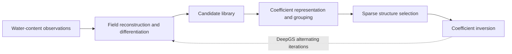

# Discovering soil water flow equations from data: methods and integration

This document describes the four published methods behind DeepGS Toolkit and how their code was integrated. All four are successive iterations of one approach, variants of SINDy that recover the structure and coefficients of a governing equation from observed water content. The description is based on the four papers and their code.

> **Current architecture (2026-10-31).** The software's main workflow is *structure selection → fixed-structure PINN inversion*; it no longer alternates between selecting a structure and training. This document also covers the original methods and the historical implementation.
>
> - Current interface: [two-stage guide](two_stage_guide.md)
> - Checks performed: [release validation](release_validation.md)
> - Directory rules: [directory layout](directory_layout.md)
> - Local archives: design and migration records in `intermediate/planning/`, historical diagnostics in `intermediate/history/`

This document distinguishes the original methods, the integrated implementation and unverified extensions.

## 1. The four generations at a glance

| Generation | Method | Paper | Problem addressed | `deepgs` pipeline |
|---|---|---|---|---|
| 1 | Group sparse regression (DNN-GSR) | Song et al., 2022, WRR, [10.1029/2022WR031926](https://doi.org/10.1029/2022WR031926) | Coefficients vary with θ, which ordinary SINDy cannot handle | `gsr` |
| 2 | DeepGS | Song et al., 2023, WRR, [10.1029/2022WR034122](https://doi.org/10.1029/2022WR034122) | Derivatives are unreliable when observations are sparse and noisy | `deepgs` |
| 3 | Extended-DeepGS | Song et al., 2025, WRR, [10.1029/2024WR037786](https://doi.org/10.1029/2024WR037786) | In heterogeneous soil, coefficients also vary with depth | `extended_deepgs` |
| 4 | Spline-SR | Song et al., 2026, WRR, e2026WR045026 | Grouped coefficients are discrete and sensitive to noise; moves toward real soil-column observations | `spline_sr` |

Published code and data: [WRR1](https://doi.org/10.5281/zenodo.6326578), [WRR2](https://doi.org/10.5281/zenodo.7322163), [WRR3](https://doi.org/10.5281/zenodo.14551650), [WRR4 code](https://doi.org/10.5281/zenodo.22866803), [soil-column observations (Wang, 2025)](https://doi.org/10.5281/zenodo.17452389).

## 2. The shared physical target

With depth $z$ positive downward, the Richards equation for homogeneous soil can be written in terms of θ alone:

$$\theta_t = \partial_z\big(D(\theta)\,\theta_z\big) - \partial_z K(\theta)$$

Expanded, it gives exactly three candidate-library terms, whose coefficients are the soil hydraulic properties:

$$\theta_t = f_1(\theta)\,\theta_z + f_2(\theta)\,\theta_{zz} + f_3(\theta)\,\theta_z^2,\qquad f_1=-\frac{dK}{d\theta},\quad f_2=D,\quad f_3=\frac{dD}{d\theta}$$

This is the core difficulty for every method: **the coefficients are not constants but functions of the state variable θ.** The four generations differ mainly in how they represent these functions and how they obtain reliable derivatives.

For smooth heterogeneous soil, the expansion gains a candidate term 1 with no θ derivative. Its coefficient is not a constant, and all coefficients also depend on depth (WRR3 Eqs. 4–8). Discontinuous layer interfaces need additional treatment.

$$\theta_t = f_0(\theta,z) + f_1(\theta,z)\,\theta_z + f_2(\theta,z)\,\theta_{zz} + f_3(\theta,z)\,\theta_z^2$$

Here $f_2=K\,\partial_\theta\psi$ and $f_3=K\,\partial^2_\theta\psi+\partial_\theta K\,\partial_\theta\psi$ contain only local properties, while $f_0$ and $f_1$ contain $dP/dz$, the spatial gradient of the parameters.

## 3. A unified framework

All four methods decompose into the same five steps and differ only in the implementation chosen for each step.



| Step | Generation 1 | DeepGS | Extended-DeepGS | Spline-SR |
|---|---|---|---|---|
| Field reconstruction | Finite differences, or DNN fit (tanh) | Main network (tanh) | Main network (sin) | DNN (SiLU) |
| Physics constrains reconstruction | No | **Yes**, alternating | Yes, after the structure is fixed | Inversion stage only |
| Candidate library | 1 + 9 terms, up to order 3 | Same | Same | **1 + 14 terms, up to order 4** |
| Coefficient representation | Piecewise constant, grouped by θ | Groups + branch network $f_i(\theta)$ | Groups by (z, θ) + two-branch network $f_i(\theta,z)$ | **Cubic B-spline** $f_j(\theta)$ |
| Sparse solver | SGTR threshold sweep | SGTR, mask updated during training | SGTR | **Backward elimination by spline-block norm** |
| Model selection | AIC-style loss / Pareto | AIC-style loss | AIC-style loss | **Knee of the error–complexity curve** |
| Coefficient result | Grouped scatter + degree-10 polynomial | Branch network | Branch network | Original method: **nonnegative cubic polynomial**; the integrated version also offers a network form |

## 4. The algorithms

### 4.1 Generation 1: group sparse regression (SGTR)

Core assumption: samples with similar water content have approximately the same equation coefficients. Grouping "by time or space" is therefore replaced by grouping "by θ", which is the starting point of the whole line of work.

1. Differentiate. Use finite differences for noiseless data and DNN + automatic differentiation for noisy data. The original `sources_SGTR/auto_diff.py` averages candidate libraries over 5 seeds. The original files are kept locally in `intermediate/references/`; public sources are listed in Section 1.
2. Normalize columns, sort by θ and split into windows of width `win` (order 0.001), with at least `min_lim` samples per group.
3. The coefficients of one candidate term across all groups form a "group". Each group fits a local regression: $\theta_t^{(g)} = \Theta^{(g)}\xi^{(g)}$.
4. SGTR: delete a whole term when the $\ell_2$ norm of its group coefficients falls below the threshold, then refit without bias.
5. Sweep `ntol` thresholds and select a model by AIC-style loss or the Pareto front:

$$L = N\ln\!\big(\mathrm{RSS}/N+\epsilon\big)+2k$$

6. Post-process coefficients (`dnn-gsr/step3_poly_fit_coef.py`): remove outliers with LOF and fit a degree-10 polynomial.

Limitations: coefficients are independent across groups, so the result is a discrete scatter; it depends on derivative quality; it requires homogeneous soil.

### 4.2 Generation 2: DeepGS

DeepGS closes the loop between sparse regression and a PINN: sparse regression provides the equation structure, and the equation acts as a physics constraint that corrects the field and its derivatives.

$$\mathcal L = \omega_d\mathcal L_d + \omega_p\mathcal L_p + \gamma\|\xi\|_0,\quad \mathcal L_p=\Big\|\theta_t-\sum_i N_i\,\xi_i(\theta)\Big\|^2$$

The $\ell_0$ term cannot be optimized directly. Group sparse regression serves as a proxy, which splits training into alternating optimization (WRR2 Algorithm 2):

1. **Pretraining** ($10^4$–$10^5$ steps): train the main network on the data loss only.
2. Predict the candidate library at residual points and run group sparse regression to obtain an initial structure mask.
3. **Alternating optimization** (about $5\times10^5$ steps): jointly train the main and branch networks, rerunning group sparse regression every $10^5$ steps to update the mask.
4. **Post-training** (about $10^5$ steps): continue training with the structure fixed, and output the field, structure and coefficients.

Key settings: $\omega_d=100$; $10^4$ residual points, with Halton sequences clearly better than random sampling.

### 4.3 Generation 3: Extended-DeepGS

Relaxes "coefficients depend only on θ" to "coefficients depend on θ and z" (WRR3 Eq. 10).

- **Coarse-grained group sparse regression (Algorithm 1, code `CGSR`):** group by depth first, then by θ within each depth, to obtain $S^{(i,k)}$. The unknowns of the block-diagonal system become $\xi(\bar\theta^{(i,k)},z_i)$. The code normalizes per group, so the AIC ε is $10^{1.2}$, which is not directly comparable to the global normalization of earlier generations.
- **Two-branch network (Algorithm 2):** θ and z each pass through a small network, are concatenated and yield $\xi_i(\theta,z)$. Algorithm 1 determines the structure once; joint training then uses $\omega_p\mathcal L_p+\omega_d\mathcal L_d$ ($\omega_p=10,\ \omega_d=1$, $2\times10^5$ residual points).
- Unlike DeepGS, the structure is **no longer updated alternately**, and the main network uses sin activation.

**Implementation limit:** the original `main.py::NN_f` and the integrated default network output linearly right after concatenation, so they represent $a(\theta)+b(z)$ and cannot express general θ–z interaction. The integrated version adds an optional nonlinear `fusion_hidden` layer; an empty list preserves the original structure. Unit tests cover its ability to represent interaction, but its scientific accuracy still needs paired experiments.

### 4.4 Generation 4: Spline-SR

Turns discrete grouped coefficients into continuous functions and separates the work into two independent stages, "select the structure, then determine the coefficients", for use with real soil-column observations.

**Structure selection** (WRR4 Section 2.3). Each coefficient is expanded in B-splines, and the regression remains linear in the spline coefficients:

$$\xi_j(\theta)=\sum_{k=1}^{K}\beta_{jk}B_k(\theta),\qquad \Phi_{q,j,k}=\tilde a_{qj}\,B_k(\bar\theta_l),\ \ q\in G_l$$

1. A DNN reconstructs the field, and automatic differentiation yields the 1 + 14 term candidate library.
2. Normalize columns and group by θ. **Basis functions are evaluated at the group centers $\bar\theta_l$:** the groups remain, but their coefficients are no longer independent because one spline curve constrains them. In the code $K=10$, giving 150 unknowns for 15 terms.
3. Solve the global ridge regression $\min\|\tilde y-\Phi_S\beta_S\|^2+\lambda\|\beta_S\|^2$.
4. **Backward elimination:** repeatedly delete the whole term with the smallest spline-block norm $\|\beta_j\|_2$ until none remain, giving a path of 16 models (including the empty model).
5. Pick the knee of the error–complexity curve (the code applies Kneedle to the $\log_{10}$ error).

**Coefficient inversion** (WRR4 Section 2.4, code `coefficient_inversion.py`). With the structure fixed, a new field network is trained, and the coefficients are represented as:

$$f_j(\theta)=s_j\sum_{k=0}^{3}c_{jk}\,q^k,\quad c_{jk}\ge 0,\quad q=\frac{\theta-\theta_{\min}}{\theta_{\max}-\theta_{\min}}\in[0,1]$$

Nonnegative coefficients fix the sign, the direction of monotonicity and the direction of curvature (a positive sign is convex, a negative sign concave; $s=(-1,+1,+1)$ comes from physical priors). Training uses variable projection: each step first solves the 12 values of $c_{jk}$ by bounded least squares (BVLS), treats them as constants, and then updates the field network with Adam. The loss is $100\mathcal L_d+\mathcal L_{\rm PDE}$ with 2000 collocation points, 90% of which are sampled in proportion to the observed rate of change. The integrated version also offers network coefficients; `benchmarks/inversion_suite.py` compares the two forms on the same budget.

## 5. Integration

### 5.1 Package structure

The code turns the five steps of Section 3 into replaceable components. Reproducing a paper's accuracy and the validity of a new combination must each be verified separately. Spline structure selection does not currently support depth-dependent grouping.

```text
src/deepgs/
├── api.py              # Public Python entry points: run, select, invert, load_model
├── cli.py              # Command line: deepgs methods | validate-data | init | run | legacy
├── workflow.py         # Two-stage run: load data, build library, select, invert, save
├── experiment.py       # Schema-2 configuration: dataclasses and validation
├── capabilities.py     # Supported selector / soil / coefficient-form combinations
├── template_api.py     # Writes editable configurations from templates/
├── data.py             # Observation readers, noise, resampling
├── datasets.py         # Standard dataset format and validation
├── library.py          # Candidate term names, finite differences, automatic differentiation
├── grouping.py         # Group by θ or (z, θ); global or per-group normalization
├── sparse.py           # SGTR, spline backward elimination, AIC, Kneedle
├── selection.py        # Structure-selection stage
├── networks.py         # Field networks (tanh / sin / SiLU), branch networks f(θ), f(θ, z)
├── pinn.py             # Data fitting and physics-constrained training
├── coefficients.py     # Coefficient representations for inversion
├── bspline.py          # Differentiable B-spline basis
├── fixed_inversion.py  # Fixed-structure inversion stage
├── contracts.py        # Results passed between stages
├── artifacts.py        # Saving results and reloading models
├── provenance.py       # File hashes and run manifests
├── physics.py          # van Genuchten K, D and their derivatives (single implementation)
├── utils.py            # Device selection, seeds, JSON output
├── config.py           # Historical pipeline configurations (legacy entry)
├── inversion.py        # Network or nonnegative cubic polynomial inversion; collocation and BVLS helpers
└── pipelines.py        # Historical pipelines: gsr, deepgs, extended_deepgs, spline_sr
```

### 5.2 Where the original code went

| Original file | Now in | Notes |
|---|---|---|
| Grouping and SGTR from `sources_SGTR/`, `DeepGS.py`, `dnn-gsr/` | `grouping.py`, `sparse.py` | Three copies merged; grouping unified to non-overlapping windows |
| Three copies of the `VG_*` formulas | `physics.py` | Uses the corrected D(θ), with a numerical check in the tests |
| `sources_SGTR/auto_diff.py`, `finite_diff.py` | `library.py`, `pinn.py` | Rewritten from TF1 to PyTorch; mini-batch Adam replaced by full-batch, with optional L-BFGS |
| `DeepGS.py` | `pipelines.run_deepgs` | Rewritten from TF1 to PyTorch following the paper's Algorithm 2: no reinitialization, and branch networks rebuilt only when the structure changes |
| `main.py`, `Extended_DeepGS_0918.py` | `pipelines.run_extended_deepgs` | Per-group denormalization corrected; dead `ada` code removed |
| `spline-sr/*`, `numerical_data_DNN_DIFF.py` | `sparse.py`, `inversion.py`, `pipelines.run_spline_sr` | Hard-coded cases and three-term structure removed; priors moved to configuration; checkpoint resume not migrated |
| `dnn-gsr/step3` | `pipelines.polynomial_curve` | |

Public versions of the original code are at the Zenodo links in Section 1. For verification status, see [release validation](release_validation.md).

### 5.3 Moving to PyTorch

TF1 depends on `tf.contrib` and runs only on old Python versions, which makes it unsuitable for new users to install. The numerical results of papers 1 and 2 are preserved on Zenodo, so the new repository uses PyTorch throughout and refers to the original Zenodo versions for exact reproduction.

### 5.4 Acceptance baseline

Each migrated generation had to pass these regression checks, so that integration would not break an algorithm:

1. Analytic solution: `K'`, `D` and `D'` agree with numerical differentiation.
2. Generation 1: on the finite-difference library of `intermediate/data/th.txt` (loam), SGTR selects θ_z, θ_zz and θ_z². Already confirmed on the existing code.
3. Spline-SR: on the 14-term finite-difference library of the same simulation, it selects the same three terms. Already confirmed on the existing code.
4. CGSR: on the finite-difference library and a 5%-noise DNN library of the same simulation, it selects the same three terms. Already confirmed on the existing code.
5. DeepGS, Extended-DeepGS and Spline-SR noise experiments: reproduce the recovery rates and errors reported in the papers. This requires the complete configurations on Zenodo and Text S3 of WRR4.

### 5.5 Data

The homogeneous example uses `intermediate/data/th.txt`, and the heterogeneous example uses `intermediate/data/loam_all_0.2/`. Data hashes, parameter assumptions and publication status are in [data provenance](data_provenance.md).
